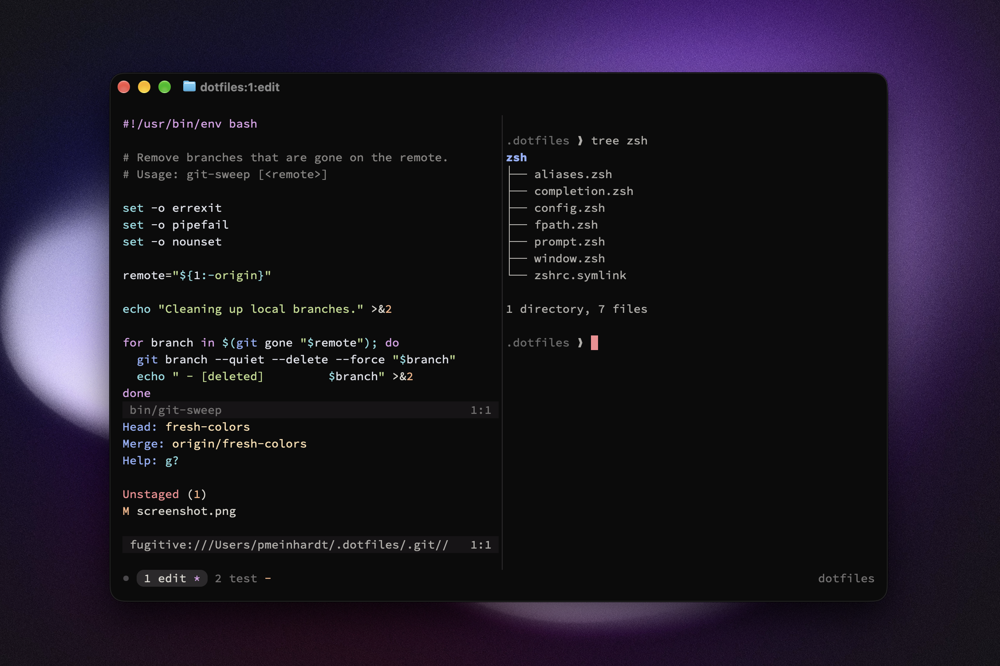

# dotfiles

Your [dotfiles](https://dotfiles.github.io/) are how you personalize your system.

Here’s how I set up mine.



## About 🔭

Everything’s built around topic areas. Each topic has its own directory.

There are a few special files in the hierarchy.

- **Brewfile**: Contains a list of tools for [Homebrew](https://github.com/Homebrew/brew) to install. You might want to edit this file before running any initial setup.
- **bin/**: Anything in here will get added to your `$PATH`.
- **topic/\*.zsh**: Files ending in `.zsh` get loaded into your environment.
- **topic/path.zsh**: Files named `path.zsh` are loaded first and are expected to set up `$PATH` or similar.
- **topic/completion.zsh**: Files named `completion.zsh` are loaded last and are expected to set up autocomplete.
- **topic/install.sh**: Files named `install.sh` are executed when you run `script/install`. To avoid being loaded automatically, their extension is `.sh`, not `.zsh`.
- **topic/\*.symlink**: Files named `*.symlink` get symlinked into your `$HOME`. This is so you can keep them versioned in your dotfiles repo while also making them available in your home directory.

## Installation 🪛

To get started, run:

```sh
# Clone this repository
git clone https://github.com/pmeinhardt/dotfiles.git ~/.dotfiles

# Change into the new directory
cd ~/.dotfiles

# Run the bootstrap script
./script/bootstrap
```

This will symlink the appropriate files to your home directory.

The `bin/dots` tool is a simple helper which installs dependencies, sets sane OS defaults, and so on.
Tweak and occasionally run `dots` to keep your environment fresh and up-to-date.

If you would like to install [Homebrew](https://github.com/Homebrew/brew) to an alternative location, e.g. `~/Developer/Homebrew`, do so before running the bootstrap script.

## Code navigation and refactoring

The default leader is `\`. Install plugins with `:PlugInstall`; fzf and
ripgrep are included in the Brewfile. Neovim uses the Vim configuration through
`neovim/install.sh`.

| Mapping | Action |
| --- | --- |
| `Ctrl-P`, `<leader>b` | Find Git files or open buffers with fzf |
| `<leader>/`, `<leader>?` | Fuzzy-search current-buffer lines or search project text with ripgrep |
| `<leader>a` | Search project text with Ack (uses ripgrep when available) |
| `gd`, `gD`, `gI` | Go to definition, type definition, or implementation |
| `gr`, `gR` | Find references in ALE's list or the fzf picker |
| `<leader>t` | Search workspace symbols; type a query and press Enter |
| `K`, `gK`, `<leader>i` | Hover information or diagnostic details |
| `[d`, `]d`, `[D`, `]D` | Navigate diagnostics |
| `<leader>r`, `gA` | Rename a symbol or apply a code action (`gA` also works on a visual selection) |
| `<leader>f` | Run the configured ALE fixer |

Use `Ctrl-O` to jump back after navigating. fzf's preview is hidden by default;
toggle it with `Ctrl-Space`. Text searches match text, while ALE's semantic
navigation and refactoring depend on the language server and its capabilities.
The LSP-specific mappings are buffer-local and appear after ALE starts a server.
Install the appropriate server separately and use `:ALEInfo` to inspect the
active linters and troubleshoot startup. The fzf reference picker additionally
requires both fzf plugins and the fzf executable. ALE's workspace-symbol search
requires an LSP server with that capability; ALE's `tsserver` integration does
not support it. In ALE's fzf reference picker, use Enter to open a result;
the custom `Ctrl-Q` quickfix action is not supported there. To put references
in the quickfix list instead, run `:ALEFindReferences -quickfix`.

Before renaming, use `gr` or `gR` to inspect references. Rename and code actions
can change multiple files, and ALE may apply a single code action immediately;
they are not guaranteed to provide a preview. Review the affected buffers and
saved changes (for example with `:Git`), and use undo in each affected buffer
or Git to discard unwanted saved changes. Take care not to discard unrelated
work.

## Thanks 🙇

This project is adapted from [Zach Holman](https://github.com/holman)’s neat [dotfiles](https://github.com/holman/dotfiles), trimming down on parts and pulling in pieces from:

- [Carlos Alexandro Becker](https://github.com/caarlos0/dotfiles)
- [Gary Bernhardt](https://github.com/garybernhardt/dotfiles)
- [Gianni Chiappetta](https://github.com/gf3/dotfiles)
- [Jan Moesen](https://github.com/janmoesen/tilde)
- [Mathias Bynens](https://github.com/mathiasbynens/dotfiles)
- [Nick Nisi](https://github.com/nicknisi/dotfiles)
- [Tim Pope](https://github.com/tpope/tpope)
- and many more.

Special thanks to [Tim Pope](https://github.com/tpope/) for his excellent Vim plugins.
